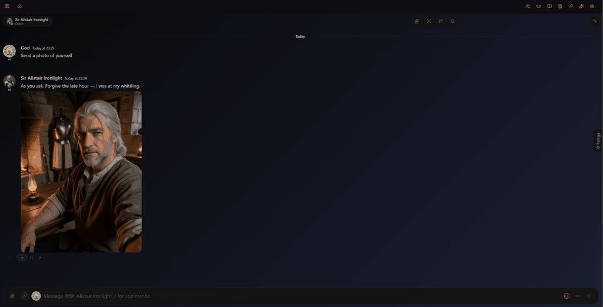

# Marinara Image Regeneration



Image Prompt Regeneration is an external extension for [Marinara Engine](https://github.com/Pasta-Devs/Marinara-Engine). It adds AI prompt editing to Marinara's **Regenerate image** dialog, so you can describe a change to an existing illustration or selfie and generate another version of it. You can review the revised prompt before making an image, or revise the prompt and generate the image in one step.

It works with Illustrator images in Roleplay and Game chats and selfies in Conversation chats. The image is still generated through Marinara's normal image workflow.

## Before you install

- You need a Marinara Engine installation that supports external extensions. This extension targets the regeneration dialog in Marinara v2.5.2 and earlier; later UI changes may affect it.
- Install and configure Marinara's **Illustrator** agent. Configure a text **Illustrator Prompt Model** connection, or a main chat text connection that it can use, and an image generation connection for the chat.

## Install

Offstage is an **External Extension with full page access**, so Marinara asks you to unlock
third-party extensions first.

1. **Allow external extensions on the host.** Open the `.env` file in your Marinara folder
   (on Windows usually `%LOCALAPPDATA%\Marinara-Engine\.env`) and set
    ```
    ENABLE_EXTERNAL_EXTENSIONS=true
    ```
    Add the line if it isn't there. Restart Marinara.
2. **Allow imports in the app.** **Settings → Advanced → Danger Zone**, read the warning, turn on
   **Allow third-party extension imports** and confirm **I Understand, Enable**.
3. **Import.** Download `image-regen.zip` from
   [Releases](../../releases) (don't unzip it). **Settings → Addons → External Extensions →
   Import Extension File** and pick the zip.
4. **Approve.** Image Prompt Regeneration appears disabled, marked _Needs approval · Full page access_. Press the
   power icon on its row (**Review and run**) and confirm **Run Exact Code**.

## Use it

1. Open an Illustrator image from a message or the chat Gallery, then click **Regenerate image** icon.
2. In **AI guidance**, describe the change you want. For example: `Keep the character and pose, but change the setting to a rainy street at night.` You can leave this blank to request a faithful alternate wording of the saved prompt.
3. Choose what to do next:

    | Control               | What it does                                                                                                                               |
    | --------------------- | ------------------------------------------------------------------------------------------------------------------------------------------ |
    | **Generate Prompt**   | Revises **Prompt** and **Negative prompt** without generating an image. Review or edit the fields, then use **Generate image** when ready. |
    | **Generate image**    | Uses the prompt fields currently shown in the dialog, without asking the prompt model to revise them.                                      |
    | **Generate**          | Revises both prompt fields, then starts Marinara's normal image generation.                                                                |
    | **Reset to original** | Restores the saved value of the adjacent prompt field. Each field has its own reset button.                                                |

The new gallery image saves the prompts submitted for that generation. If you open **Regenerate image** on the new image later, those prompts are its originals. **AI guidance** is temporary and is not saved with the image.

## Build from source (optional)

If you prefer to build the extension yourself, install Node.js 20 or newer, then run these commands in the project folder:

```sh
npm ci
npm run build
```

Import `dist/image-regen.zip` as an **Extension File**, or `dist/package/` as an **Extension Folder**. The ZIP contains `manifest.json`, `extension.js`, and `extension.css` at its root.

For contributors, `npm test` runs the automated tests. They cover the dialog and mocked Marinara APIs; a live Marinara installation is needed to check the actual import and UI.

## Uninstall

**Settings → External Extensions → Delete** on Image Prompt Regeneration.

## License

MIT
